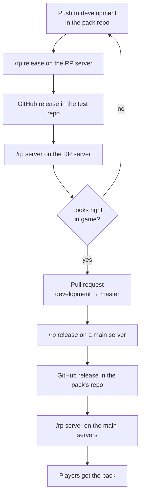
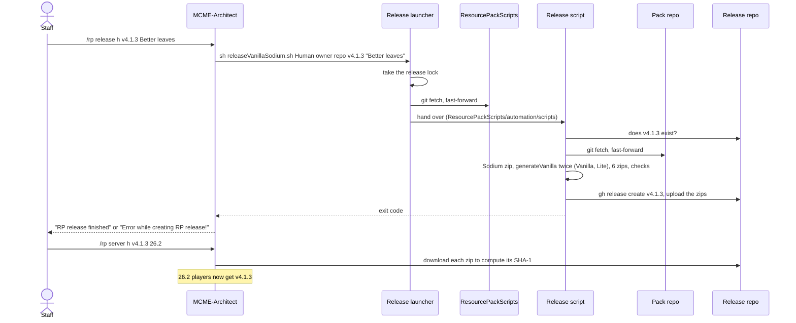

# The release pipeline

What happens between `/rp release` in game and a player downloading the new pack. If your pack isn't in the pipeline yet, read [Set up a pack repository](pack-repository.md) first.

- [Two stages: test, then production](#two-stages-test-then-production)
- [1. Before you release](#1-before-you-release)
- [2. Start the release in game](#2-start-the-release-in-game)
- [3. The plugin starts the release script](#3-the-plugin-starts-the-release-script)
- [4. The launcher, the lock and the wrapper](#4-the-launcher-the-lock-and-the-wrapper)
- [5. The release script, step by step](#5-the-release-script-step-by-step)
- [6. The result](#6-the-result)
- [7. Put the release on a server](#7-put-the-release-on-a-server)
- [8. Players get the pack](#8-players-get-the-pack)
- [How long a release takes](#how-long-a-release-takes)

## Two stages: test, then production

Every pack goes through the same steps twice. Once on the **RP server**, which is the test stage. Then once on a **main server** such as mainworld or moria, which is production.

| | Test: the RP server | Production: the main servers |
|---|---|---|
| Pack branch that is built | `development` | `master` |
| ResourcePackScripts branch used | `development` | `master` |
| Where the GitHub release goes | A test repository, such as `EriolEandur/RP-Gondor` for Human | The pack's own repository, such as `MCME/RP-Human` |
| Who gets the pack | Players on the RP server | Players on the servers whose slots you update |
| Release lock: one release at a time | Yes | Yes |
| A release with a tag that exists | Replaces that release's zips | Refused before anything is built |
| Pipeline wrapper (run log, summary) | Yes | Not yet |



The rest of this page follows one release through the steps. They're the same on both stages, except where a step says otherwise.



Two commands, two separate decisions:

- **`/rp release`** builds the zips and publishes them as a GitHub release. Nobody gets them yet.
- **`/rp server`** points a Minecraft version's slot at a release. From then on, players get that release.

So you can look at a release before it reaches players, and going back to an older release is a single `/rp server` command.

## 1. Before you release

- **Push your work to the branch the stage builds from**: `development` for the RP server, `master` for production. At the start of every release the server brings its checkout of the pack up to date with that branch on GitHub, and builds what GitHub has. Work that is only on your computer, or on another branch, isn't in the release.
- **Pick a new version tag**, for example `v4.1.4`. It becomes part of every download URL, so use only letters, digits, dots, dashes and underscores, starting with a letter or digit: the release scripts refuse any other tag before they build anything. Keep it short: the plugin stores each player's pack URL in a 100-character column, and today's longest URLs are already 96 characters.
- **Use a new tag for every release.** On the RP server, reusing a tag replaces that release's zips. On production, a tag that exists is refused before anything is built (see [Re-running a release](troubleshooting.md#re-running-a-release)).
- **Optional but recommended:** run the conversion on your own computer with generateVanilla (see the [README](../README.md#generate-the-vanilla-pack)) and read the warnings. The server runs the same code.

## 2. Start the release in game

```
/rp release <pack> <version tag> <release title>
```

| Part | Example | Notes |
|---|---|---|
| `<pack>` | `h` or `Human` | The pack's name in the server's config, or the start of it. The server takes the **first** pack in its config whose name starts with what you typed, ignoring case: `h` is Human, `m` Mordor, `d` Dwarven, `r` Rohan, `l` Lothlorien, `p` Paths of the Dead. |
| `<version tag>` | `v4.1.3` | The Git tag of the release, and part of every download URL |
| `<release title>` | `Better leaves` | The title of the GitHub release. Everything after the tag counts, spaces included. |

- **You need the permission `architect.resourcePackAdmin`.** The command also works from the server console.
- **Run it on the server of the stage you want**: the RP server for a test release, a main server for production.
- **The build runs in the background.** Its output goes to that server's MCME-Architect log, not to your chat (see [Where the output goes](#where-the-output-goes)). You get one chat message when it ends (see [The result](#6-the-result)).

## 3. The plugin starts the release script

MCME-Architect looks the pack up in the `gitHubRpReleases` section of its config (see [Add a pack to the automation](server-setup.md)). That gives:

- **the script** that builds the pack:
  - `releaseVanillaSodium.sh` for a Sodium pack, which makes six zips;
  - `releaseGeneral.sh` for a vanilla-only pack, which makes two;
  - `releaseDynmap.sh` for the dynmap texture pack, which makes one zip for dynmap and publishes nothing;
- **the GitHub repository** that gets the release (owner and repo);
- **the automation folder** the script runs in.

It runs `sh <script> <Pack> <owner> <repo> <tag> <title>` in that folder and waits.

> [!IMPORTANT]
> The plugin waits up to **30 minutes**, or `timeoutMinutes` from the pack's `gitHubRpReleases` entry. A release still running then is stopped, with everything it started, and the chat message says `Process terminated=false`. A Human release takes a little over 5 minutes (see [How long a release takes](#how-long-a-release-takes)).

### Where the output goes

MCME-Architect writes every line the release prints, its errors included, to its own log, marked with the pack: `[2026-10-06 14:05:01] [INFO] [RP release Human] compiling Human RP zips`. The log is in the folder of the server where `/rp release` ran:

```
plugins/MCME-Architect/logs/architect_<date>_<time>_<n>.log
```

`<date>_<time>` is when the server started, such as `2026-10-06_14-03-12`, and the newest file of that start ends in `_0`. By default Architect keeps 14 days of them. To read a pack's last release:

```bash
grep -hF '[RP release Human]' plugins/MCME-Architect/logs/architect_*.log | tail -n 50
```

The server console and `logs/latest.log` get these lines too only when `alsoServerLog` is `true` in the `logging.file` section of Architect's `config.yml`. It's `false` by default. With `enabled: false` in that section, Architect keeps no log of its own, and the lines go to the server console and `logs/latest.log` instead.

## 4. The launcher, the lock and the wrapper

The release scripts in the automation folder aren't the scripts themselves. Each is a copy of the **release launcher**, `automation/launcher.sh` in this repository, which `install.py` put there. Before anything is built, it:

1. **takes the release lock.** Every release script builds in the same `release/` folder, so two releases at once would mix their files. While one release runs, a second is refused and starts nothing: Architect's log says which release is running, and the chat message shows `exitCode=75`. Run `/rp release` again once the first has finished. This holds on both stages.
2. **brings the folder's ResourcePackScripts checkout up to date** with its branch on GitHub: `development` on the RP server, `master` on production. A change merged here reaches the next release on that stage. It refuses (`exitCode=3`) when the checkout was edited on the server, is on another branch, or has commits GitHub doesn't have. If GitHub can't be reached, it warns and uses what it fetched last.
3. **reads the folder's settings**, `automation.conf` (see [The automation folder's settings](server-setup.md#the-automation-folders-settings)).
4. **hands over** to the release script of the same name in `ResourcePackScripts/automation/scripts/`. On the RP server it goes through the pipeline wrapper.

What `development` has that production's `master` doesn't yet: [compare `master...development`](https://github.com/MCME/ResourcePackScripts/compare/master...development).

### The pipeline wrapper (RP server only)

The wrapper, in `automation/pipeline/`, runs the script and adds:

- **A log of every run.** Every output line is kept with a timestamp. The generator's `--debug` lines (about 120,000 per Human release) go only to the full log. Everything else still reaches MCME-Architect, and so its log. Full logs are kept for the last 30 runs, the part without the `--debug` lines for the last 200, summaries for good.
- **A summary of every run.** It records the steps and how long each took, every zip with its file count, warnings, errors, the GitHub release URL, the stage, branch and ResourcePackScripts commit the release ran with, and a status:

| Status | Meaning |
|---|---|
| `ok` | Finished, with no warnings and no problems |
| `warnings` | Finished, but the generator or the script printed warnings. Normal for Human and Mordor; read them anyway. |
| `failed` | An error line, or a problem with a zip or the GitHub release (see below) |
| `interrupted` | The run was cut off, for example by a server restart. The next release tidies up after it. |

The summary flags these problems even when the script ended with exit code 0:

- a zip that 7-Zip didn't finish, or that is **empty**;
- a zip with **under 90 %** of the files the same zip had in the pack's last good release, which usually means the conversion broke half-way;
- **no GitHub release** created.

The verdict is the `Release run …` line near the end of the run's output, in Architect's log and in the run's log, followed by one line for each problem. For example:

```
Release run 20260930-050612-Human-v4.1.3: OK with warnings, released. 10 warning(s), 0 error(s). Human-Sodium.zip 16,075 files, ...
```

Staff with access to the admin dashboard can read every run there, with its steps, warnings and full log, on the **Resource packs** page.

> [!NOTE]
> Production doesn't use the wrapper yet, so its releases have no run log or summary. Read the release's lines in Architect's log there (see [Where the output goes](#where-the-output-goes)).

The launcher, the release scripts and the wrapper are in this repository, under `automation/`. The server runs them from its checkout and never edits them.

## 5. The release script, step by step

### Sodium packs: `releaseVanillaSodium.sh` (six zips)

Used by Human and Mordor. `<Pack>` is the pack's name in the config, for example `Human`. The server's checkout of the pack is the folder `<Pack>-Sodium`.

Before the first step, the script checks its arguments and asks GitHub whether the tag exists. On production a tag that exists stops it there, and nothing is built.

| Step (line in the output) | What happens | Output |
|---|---|---|
| `compiling <Pack> RP zips` | Start | |
| `<Pack>-Sodium` | `<Pack>-Sodium` is brought up to date with GitHub, or the release stops (see [Details that matter](#details-that-matter)). The pack is copied to `release/` and zipped as it is, **without** its `vanilla/` folder. The shader base is already in the repository, written by [the sync](shader-base.md#getting-it-into-a-pack). | `<Pack>-Sodium.zip` |
| `<Pack>-Sodium-Footprints` | The footprints texture is copied over `activator_rail.png` and the folder is zipped again. | `<Pack>-Sodium-Footprints.zip` |
| `<Pack>-Vanilla` | `release/` is emptied, then generateVanilla converts the Sodium pack into it, walking `Vanilla-26.2`. Under the wrapper it also writes `--debug` lines, which go to the run's full log. | `<Pack>-Vanilla.zip` |
| `<Pack>-Vanilla-Footprints` | Both footprints textures (`activator_rail.png`, `activator_rail_on.png`) are copied in and the folder is zipped again. | `<Pack>-Vanilla-Footprints.zip` |
| `<Pack>-Lite` | `release/` is emptied, then generateVanilla runs again with `--limit 2`: at most two models per blockstate variant. | `<Pack>-Lite.zip` |
| `<Pack>-Lite-Footprints` | Footprints again | `<Pack>-Lite-Footprints.zip` |
| `releasing <Pack> RP zips` | `gh release create <tag>` in the release repository, with your title and a note worked out from the zips, such as "Version v4.1.3 for Minecraft 26.2 and 26.3": every Minecraft version all six zips support. Then `gh release upload` of all six zips, and the release URL is printed. | GitHub release |

**Each Footprints zip must differ from the zip it was made from**, or the release stops before anything is published: the footprints textures didn't make it in. **The Lite zip must differ from the Vanilla zip** in the same way. generateVanilla sets the shader base's `MCME_LITE` flag in every Lite conversion, so the two differ even for a pack with at most two models per variant, and the same files mean Lite mode didn't apply. Any failed step stops the release before it publishes: the pack's update, 7-Zip, generateVanilla, a footprints texture, or the release note. Nothing from an earlier release is ever uploaded in its place.

```mermaid
flowchart LR
    pull["Pack brought up to date<br/>with GitHub"] --> sodium["Sodium zip<br/>(pack as it is,<br/>without vanilla/)"]
    sodium --> sfp["Sodium-Footprints zip"]
    sfp --> gen1["generateVanilla"]
    gen1 --> vanilla["Vanilla zip"] --> vfp["Vanilla-Footprints zip"]
    vfp --> gen2["generateVanilla --limit 2"]
    gen2 --> lite["Lite zip"] --> lfp["Lite-Footprints zip"]
    lfp --> note["Release note<br/>from the zips"] --> gh["GitHub release:<br/>create + upload 6 zips"]
```



### Vanilla-only packs: `releaseGeneral.sh` (two zips)

Used by Rohan, Lothlorien, Dwarven and, for now, Paths of the Dead. There's no conversion: the pack is zipped as it is. The server's checkout is the folder `<Pack>-Vanilla`.

| Step | What happens | Output |
|---|---|---|
| `compiling <Pack> RP zips` | `<Pack>-Vanilla` is brought up to date with GitHub, or the release stops (see [Details that matter](#details-that-matter)). The pack is copied to `release/` and zipped, leaving out any `inventories` folder. | `<Pack>.zip` |
| (no step line) | Both footprints textures are copied in and the folder is zipped again. That zip must differ from the first, or the release stops. | `<Pack>-Footprints.zip` |
| `releasing <Pack> RP zips` | `gh release create` with the note worked out from the zips, then `gh release upload` of both zips | GitHub release |

### The dynmap pack: `releaseDynmap.sh` (one zip, no release)

It brings the checkout named exactly `<Pack>` up to date with GitHub, as the other scripts do, then zips it, leaving out any `inventories` folder, and puts `<Pack>.zip` into the dynmap plugin's texture packs: `../../baseline-server/plugins/dynmap/texturepacks/`, seen from the automation folder. It publishes nothing. Where that folder doesn't exist, as seen from the production folder, it stops before building. A stop leaves the zip already in the texture packs in place.

### Details that matter

- **The server builds what GitHub has on its checkout's branch.** Before it builds anything, the script fetches that branch from GitHub and fast-forwards the pack's checkout to it: it never merges or rebases on the server. It stops the release instead, with an `ERROR:` line that says why and who fixes it, when:
  - GitHub can't be reached;
  - someone edited or added files in the checkout on the server, or made commits there;
  - the checkout is on no branch, or on a branch that follows none on GitHub, for example one deleted there.

  See [Messages from the launcher and the scripts](troubleshooting.md#messages-from-the-launcher-and-the-scripts). Files that the pack's `.gitignore` ignores aren't checked, and would still be zipped: leave none in the checkout.
- **Files and folders at the top of the repository whose names start with a dot** (`.git`, `.gitignore`, `.github`) never end up in a zip. Deeper down they do, so don't commit `.DS_Store` and the like.
- **Everything else at the top of your repository goes into the Sodium zip and the vanilla-only zips**: `README.md`, `changelog.txt`, `blockList.txt` and so on. Keep the top level tidy.
- **ResourcePackScripts is brought up to date at the start of every release**, by the launcher. A change merged into `development` here is used by the next test release; a change merged into `master` by the next production release.
- **The converter walks Minecraft 26.2's blocks and items** (the folder `Vanilla-26.2`). Blocks added in later versions are dropped from the Vanilla and Lite zips. See [Known limits](pack-repository.md#known-limits).

## 6. The result

**In game**, the plugin sends one message when the script ends:

- the success message, `RP release finished. You might want to do /rp server <pack> <tag>`, if the script ended with exit code 0 in the plugin's time (30 minutes, unless the pack's entry sets `timeoutMinutes`);
- otherwise `Error while creating RP release! Process terminated=<true|false> exitCode=<n>`. That doesn't always mean it failed: see [Error messages in game](troubleshooting.md#error-messages-in-game).

**On GitHub**, the release appears at `https://github.com/<owner>/<repo>/releases/tag/<tag>` with its zips. `gh release create` publishes it before the zips are uploaded, so when the upload fails the release is there without all of them, and the release's `ERROR:` line says what to do (see [Messages from the launcher and the scripts](troubleshooting.md#messages-from-the-launcher-and-the-scripts)).

**For the real verdict**, read the wrapper's summary on the RP server: the `Release run …` line near the end of the run, or the dashboard's Resource packs page. On production, read the release's lines in Architect's log, and check that the release has all its zips.

## 7. Put the release on a server

```
/rp server <pack> <version tag> <Minecraft version>
```

For example `/rp server h v4.1.3 26.2`. You need `architect.resourcePackAdmin`.

1. The plugin writes the download URL of every zip of that release into its config, in a **slot** for that Minecraft version. Dots become underscores, so `26.2` is the slot `26_2`. The zip names it writes depend on the pack's config:
   - for a Sodium pack, `<Pack>-Vanilla.zip`, `-Vanilla-Footprints`, `-Sodium`, `-Sodium-Footprints`, `-Lite` and `-Lite-Footprints`;
   - otherwise, `<Pack>.zip` and `<Pack>-Footprints.zip`.
2. It saves the config.
3. It downloads each zip of the **newest** slot once and stores its SHA-1. Minecraft checks every download against it. To hash every slot instead, use `/rp calcsha <pack> all`.

> [!WARNING]
> **Type the Minecraft version exactly**: `26.2`, `1.21.4`. The plugin only knows the versions listed in its protocol table. A version it doesn't know, such as `26.2release`, still gets saved as a slot. After that, every later `/rp server` for that pack fails without a word in chat, and **no player gets that pack** until an admin removes the bad slot from the config.

**Several servers share one config file.** mainworld, moria, freebuild, plotworld, themedbuilds, pvpserver and terrain share one; hub, eventserver and the RP server each have their own. `/rp server` on one server writes the shared file, but the other servers keep their old copy in memory. Either run `/rp server` on each of them, or run it on one and then `/architect reload` on the others. Never run `/rp server` for one pack on a server that hasn't reloaded since another pack changed: it writes its old copy of the whole file back.

## 8. Players get the pack

**Which pack.** The server gives each area its pack through RP regions, which staff draw with `/rp create`. When a player with automatic switching on (the default) walks into a region, they get that region's pack. Players can also pick a pack with `/rp <pack>`, for example `/rp h`.

**Which zip.** Within a pack, the plugin picks:

- **the client type**:
  - `sodium` for players who join with the MCME modpack;
  - `vanilla` for any client that isn't Fabric;
  - `lite` only when chosen with `/rp client lite`. That choice is kept over a rejoin only on a plain Fabric client.
- **the variant**: `light` (the normal pack), or `footprints` with `/rp variant footprints`;
- **the slot**: the newest slot whose Minecraft version is not newer than the player's. A 26.2 player gets `26_2`, and a 1.21.4 player gets `1_21_4` if the pack still has it, otherwise the newest older slot.

If the pack has nothing for the player's choice, for example a Sodium player in a vanilla-only pack, the first option listed in the config is used.

**When.** Players get a new zip:

- when they join the network;
- when they walk into a different RP region;
- when they use `/rp <pack>`, `/rp reset`, `/rp client` or `/rp variant`.

**Nothing pushes a new release to players who are already online.** After `/rp server`, they get it on their next join or region change. `/rp <pack> -force` resends the pack to **you** only, even if the URL hasn't changed. It's handy for checking a release yourself.

## How long a release takes

Measured on the RP server in September and October 2026:

| Pack | Script | Whole release | Vanilla step | Lite step |
|---|---|---|---|---|
| Human | `releaseVanillaSodium.sh` | 5 min 10 s – 5 min 40 s | about 3½ min | about 2 min |
| Mordor | `releaseVanillaSodium.sh` | about 2 min 15 s | about 1 min 20 s | under 1 min |
| Paths of the Dead | `releaseGeneral.sh` | a few seconds | | |

Almost all the time goes to generateVanilla baking the `.obj` models with objmc, once for Vanilla and once for Lite. Zipping and uploading take seconds.
